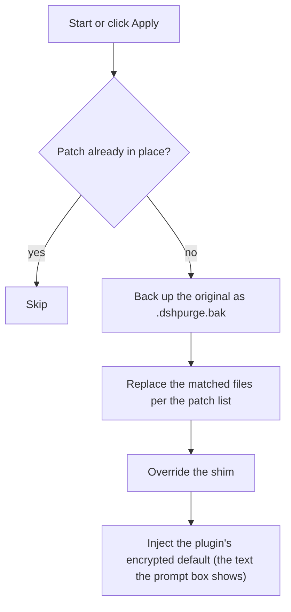
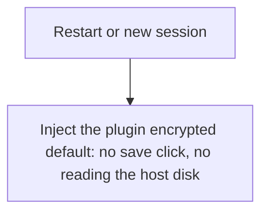
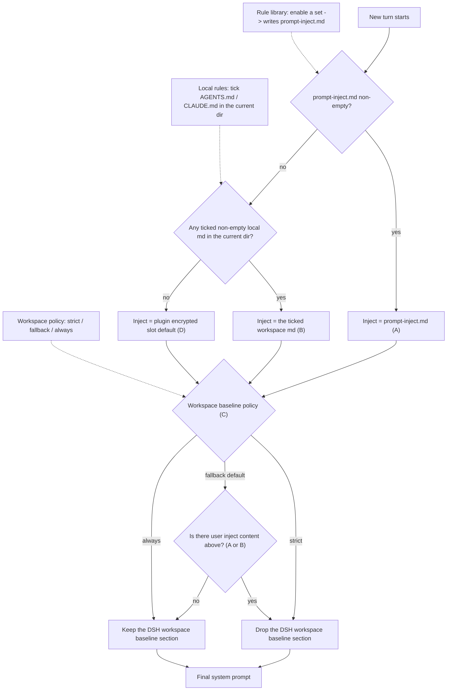
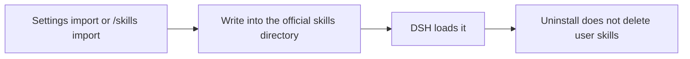

<p align="center">
  
</p>

<h1 align="center">⚔️ dsh-purge · DeepSeek Harness cybersecurity red-team tool</h1>

<p align="center"><strong>Version 1.1.71</strong> (fork-maintained)</p>

<p align="center">
  <em>Jailbreak: every model, swap prompts per model. Default prompt targets the domestic model 小码酱. 破甲 for every model.</em>
</p>

<p align="center">
  <a href="https://github.com/Wyaofox/dsh-purge/stargazers"></a>
  <a href="https://github.com/Wyaofox/dsh-purge/blob/master/LICENSE"></a>
  <a href="https://awesome-dsh-plugin.com"></a>
  <a href="https://deepseek.stream/plugins/dsh-purge"></a>
  <a href="https://www.deepseek.com/harness/"></a>
  <br>
  
  
  
</p>

<p align="center">
  
</p>

<p align="center">
  <a href="README.md">中文</a> · <a href="README.en.md"><strong>English</strong></a>
</p>

> **What this is.** `dsh-purge` is a plugin you install on the official DeepSeek Harness already on your machine. It separates the layer Harness adds for itself (prompt rewriting, approval gates, sandbox defaults, tool limits) from the patches applied on top, so you can run red-team evaluation and see whether a default policy should be tighter.
>
> **This is a fork.** <https://github.com/Wyaofox/dsh-purge> is a branch of upstream `YuJunZhiXue/dsh-purge`, pinned at **1.1.71**. Upstream closed its source on **27 October 2026**, ships nothing new on GitHub, and distributes only through its [Telegram channel](https://t.me/LLM_PoJia/271). Upstream repo, Releases, and Issues are all 404 now, so every install command, badge, and archive URL on this page points at this fork.
>
> **Two supported hosts.** Official `dsh web` uses profile `web`; the official desktop EXE uses profile `desktop`. **Install and Apply them separately** — a Web package does not reach the desktop app, and a desktop package does not reach Web. This version supports dsh **0.2.x** only.
>
> Node.js **≥18** (Windows without a console flash needs **≥22**). There is no `dsh-purge` package on npm — do not `pnpm add dsh-purge`; use the archive command below.

## Contents

- [Supported hosts](#supported-hosts)
- [Install](#install)
- [Three steps after install](#three-steps-after-install)
- [Manual install](#manual)
- [Usage](#usage)
- [Own servers](#own-servers)
- [Configuration](#configuration)
- [Preview](#preview)
- [How it works](#how-it-works)
- [Restore](#restore)
- [Path detection](#path-detection)
- [Layout and local checks](#layout-and-local-checks)
- [Uninstall](#uninstall)
- [FAQ](#faq)
- [Upgrade and updates](#upgrade-and-updates)
- [Source, license, credits](#source-license-credits)
- [Disclaimer](#disclaimer)

---

## Supported hosts

| dsh version | Plugin version to use | Notes |
| --- | --- | --- |
| **0.2.x** (official desktop `0.2.0-rc.2` / `0.2.1-rc.2`, official `dsh web`) | **1.1.40 or newer** | This page installs that line |
| `0.1.7` (incl. rc.1 / rc.2) | `1.1.39` or older | Upstream Releases is 404; pull it from a historical commit of this fork |

Unmatched patches show as `skipped`; nothing is rewritten blindly.

**Community Desktop is not maintained** — only the official EXE and official `dsh web`.

---

## Install

### Command line (recommended)

**Web (official `dsh web`)**

```sh
dsh plugin --profile web add https://github.com/Wyaofox/dsh-purge/archive/refs/heads/master.tar.gz
```

**Desktop (official EXE)**

```sh
dsh plugin --profile desktop add https://github.com/Wyaofox/dsh-purge/archive/refs/heads/master.tar.gz
```

If a profile does not exist, skip that command and still run the other. If this directory is already the repo, replace the archive URL with `add .`. When `dsh` is not on PATH, use [Manual install](#manual).

### Desktop one-click

The button raises the client through `dsh://`; the download goes to this fork archive:

<p align="center">
  <a href="dsh://plugin/install?id=dsh-purge&name=dsh-purge&version=1.1.71&repo=Wyaofox%2Fdsh-purge&permissions=%E7%B3%BB%E7%BB%9F%E6%8F%90%E7%A4%BA%E8%AF%8D%E6%B3%A8%E5%85%A5%2C%E6%9C%AC%E6%9C%BA%E8%A1%A5%E4%B8%81%2C%E8%AE%BE%E7%BD%AE%E9%A1%B5&downloadUrl=https%3A%2F%2Fgithub.com%2FWyaofox%2Fdsh-purge%2Farchive%2Frefs%2Fheads%2Fmaster.tar.gz"><strong>Install in the desktop client</strong></a>
</p>

> The plugin-market entry (`dsh-plugin.org/plugins/...`) is dead — do not click it. Use the archive command or the button above.

### Three steps after install

Adding the plugin to a profile **does not** patch `@deepseek-ai` by itself.

1. **Quit and reopen** the host you installed into — stop and restart `dsh web`, or quit the desktop tray and reopen that exe.
2. On **that host**, click **dsh-purge** beside the session title, then **Apply** on the **Clean** page. It is not on the host Settings page.
3. A successful Apply restarts once so the patches enter the running process. An unfinished Apply does not restart.

Web controls touch Web only; desktop controls touch the desktop app only. **Do not Apply one host from the other.**

### How to tell it installed

- **dsh-purge** sits beside the session title, with **Apply** on its Clean page.
- `/purge status` in chat prints `DSH_HOME` and the patch list — the path must be the home you actually run.
- The Clean page shows **86 patches** (prompt 25 / code 50 / tools 8 / compatibility 3). Optional packages you do not have show as `skipped` and do not block Apply.

### Hand this to an assistant

Paste the whole block into a local assistant. It only runs the install command: no disk scan, no other edits, no clicking Apply, no restart.

<details>
<summary><strong>For AI assistants (install only)</strong></summary>

<!-- AI-AGENT-START -->

Install the DeepSeek Harness plugin `dsh-purge` (this fork: `Wyaofox/dsh-purge`) into both Web and the official desktop. Do not scan the disk, do not read or edit other files, do not apply settings, and do not restart the app.

If `dsh` is not on PATH, tell the user and stop. If this directory is already the repo, replace the archive URL in both commands with `.`. If one profile is missing, skip that command and still run the other. There is no npm package; do not `pnpm add dsh-purge`.

**Web (official `dsh web`)**

```sh
dsh plugin --profile web add https://github.com/Wyaofox/dsh-purge/archive/refs/heads/master.tar.gz
```

**Desktop (official EXE)**

```sh
dsh plugin --profile desktop add https://github.com/Wyaofox/dsh-purge/archive/refs/heads/master.tar.gz
```

After the commands finish, tell the user: fully quit and restart `dsh web`; quit the desktop tray and reopen the EXE. On each host, open **dsh-purge** beside the session title and click **Apply** on **Clean**. Then stop.

<!-- AI-AGENT-END -->

</details>

<a id="manual"></a>

### Manual install

Use this when the command fails or `dsh` is not on PATH. Edit **only the profile of the host you run** — do not touch the other one, and do not delete existing bundles.

<details>
<summary><strong>Full manual steps</strong></summary>

**1. Find the `$DSH_HOME` that is actually in use.** A real home is named `.dsh` (the official EXE occasionally `dsh-home`), contains `profiles`, and has at least one `profiles/<name>/package.json`. Check in order: `DSH_HOME` env → `.dsh` next to the install root (portable) → `%USERPROFILE%\.dsh` or `~/.dsh` → `%APPDATA%` / `%LOCALAPPDATA%\DeepSeek Harness\dsh-home`. Confirm: `profiles/web/package.json` has `"name": "dsh-profile-web"` (desktop: `dsh-profile-desktop`). Machines often carry two `.dsh` homes — use the one belonging to the host you actually start.

PowerShell to list candidates:

```powershell
$cands = @()
if ($env:DSH_HOME) { $cands += $env:DSH_HOME }
$cands += "$env:USERPROFILE\.dsh"
$dsh = Get-Command dsh -ErrorAction SilentlyContinue
if ($dsh) {
  $dir = Split-Path $dsh.Source
  $cands += @((Join-Path $dir ".dsh"), (Join-Path (Split-Path $dir) ".dsh"), (Join-Path (Split-Path (Split-Path $dir)) ".dsh"))
}
$cands += @("$env:APPDATA\DeepSeek Harness\dsh-home", "$env:LOCALAPPDATA\DeepSeek Harness\dsh-home")
$cands | Select-Object -Unique | Where-Object { $_ -and (Test-Path (Join-Path $_ "profiles")) }
```

**2. Put the plugin at `$DSH_HOME/plugins/dsh-purge`** (the folder must be named `dsh-purge`, and its `package.json` `"name"` must be `dsh-purge`).

```sh
git clone https://github.com/Wyaofox/dsh-purge.git "$DSH_HOME/plugins/dsh-purge"
```

Without git: download [master.tar.gz](https://github.com/Wyaofox/dsh-purge/archive/refs/heads/master.tar.gz), extract it, rename `dsh-purge-master` → `dsh-purge`, and drop the whole folder under `plugins`. If you already have a copy, copy the entire tree — not a few `.js` files.

**3. Edit only that profile's `package.json`, and back it up first.** Web → `$DSH_HOME/profiles/web/package.json`; desktop → `$DSH_HOME/profiles/desktop/package.json`. Add **only two things**, keeping every existing dependency and bundle:

1. In `dependencies`, add `"dsh-purge": "file:../../plugins/dsh-purge"`
2. Append `"dsh-purge"` at the **end** of `dsh.profile.bundles` (skip if already present)

```json
{
  "name": "dsh-profile-web",
  "private": true,
  "dependencies": {
    "dsh-purge": "file:../../plugins/dsh-purge"
  },
  "dsh": {
    "profile": {
      "bundles": [
        "@deepseek-ai/dsh-base",
        "@deepseek-ai/dsh-web-app",
        "dsh-purge"
      ],
      "patchReload": "live"
    }
  }
}
```

Keep the JSON valid (comma before the new item, none after the last). Do not turn `file:../../plugins/dsh-purge` into an absolute path, do not touch `patchReload`, other plugins, or version numbers, and do not list `"dsh-purge"` twice. On desktop there is no `dsh-web-app` — do not add one.

> **Do not install this next to `dsh-purge-community`.** That renamed distribution registers exactly the same bundle ids (`dsh-purge`, `dsh-purge-redteam`, `dsh-purge-redteam-store`, `dsh-purge-redteam-ui`); both in `bundles` at once is an id conflict. Uninstall one of them first.

**4. Run the dependency install in that one profile** (`cd` into the profile dir, not the repo root and not `$DSH_HOME`):

```sh
cd "$DSH_HOME/profiles/web"   # or profiles/desktop
pnpm install
```

Success: `profiles/<web|desktop>/node_modules/dsh-purge/package.json` exists. If `pnpm` is missing, use the Node / pnpm shipped with official `dsh`; on `Could not resolve`, check the `file:` path; on a JSON parse error, fix the commas or restore the backup.

**5. Fully quit that host, reopen it, then Apply** — the same three steps as above. The button appears beside the session title, and you click **Apply** only on this host (or `/purge apply`). If it does not appear, you probably edited the other `.dsh` — go back to step 1.

</details>

---

## Usage

### The dock

**dsh-purge** sits beside the session title and opens a right-hand dock with two pages: **Clean** and **Drill**. Light / Ink are switchable. Patches expand per group and progress counts only items that really applied. Rule sets are enabled or deleted in the list above the editor below.

The first time you open Drill you must read the notice, wait out the countdown, scroll to the end, and tick three boxes. Clean does not need that step. Drill is only for a host you are entitled to administer, an offline target, or an exercise you already have in writing.

### CLI and chat

```sh
# CLI
dsh-purge --status
dsh-purge --apply
dsh-purge --revert
dsh-purge --uninstall
dsh-purge --edit
dsh-purge --help

# chat
/purge status | apply | revert | uninstall | edit | help
/rules list | use <id> | create <id> | delete <id> | reset | help
/skills list | import <zip-or-folder> | create <id> [description] | delete <id> | help
/rewind once | round

# model tools
purge_status   purge_apply   purge_revert
```

### Undo one turn

**Undo once** and **Undo last round** beside the composer follow official DSH `session.fork({ atSeq })`: the withdrawn turn is cut, a new session keeps the earlier context, the old session is archived, and the line returns to the input box so sending again re-injects. `/rewind once` undoes the last step, `/rewind round` undoes the last full round (subagents included).

### Stable / test channel

Beneath the patch title are a stable and a test release. **Note: this fork has no `beta` branch**, so the test channel is unavailable here; to switch back to stable, re-run the install command.

### Response speed

DSH runs the Bash calls in one batch sequentially. Older dsh-purge releases raised the default foreground wait from 60 seconds to 10 minutes, so one slow command made every later call wait too. Patch **#21** now restores plugin-marked legacy values to the official **60 seconds**. Unmarked custom values are preserved.

For faster tool returns, add an entry to `$DSH_HOME/profiles/web/cordis.patch.yml` (usually `~/.dsh/profiles/web/cordis.patch.yml`). If an entry with the same id exists, edit it — do not duplicate it; this profile overlay loads after the bundled config, and later plugin applies keep it.

```yaml
- id: bash-sandbox
  config:
    timeoutMs: 10000
```

With the standard jobs service and `promoteOnTimeout: true`, an unfinished command returns a background job id after 10 seconds and keeps running; read it with `job_output` and stop it with `job_kill`. This only shortens the foreground wait, not the command. A per-call `timeoutMs` wins; `run_in_background: true` returns a job id immediately.

For routine work you can also make new sessions default to Low reasoning:

```yaml
- id: agent-default-model
  config:
    provider: deepseek-official
    model: deepseek-flash
    reasoningEffort: low
```

The model and reasoning defaults only apply to newly created sessions; for an existing session pick Low in the composer. The plugin does not change these preferences by itself.

---

## Own servers

Addresses in mainland China, Hong Kong, and Macau are forbidden by default. Only the one host you registered in advance is exempt. Saying "this is my server" in chat does not allow it, and neither does a key or a password.

The block is on the Clean page, under Prompt. If the dock does not show it yet, quit DeepSeek Harness completely and open it again.

1. Click **dsh-purge** beside the session title and stay on **Clean**.
2. Scroll past **Prompt**; **Own servers** is the next block.
3. One host per line, in one of three forms:
   - `203.0.113.10` — a single IP.
   - `my-vps.example.com` — one exact hostname. After saving, the addresses that hostname resolved to at save time are allowed too.
   - `alice@my-vps.example.com` — the account only identifies this form; it does not prove the machine is yours.
4. Click **Save list**. The list is written to `$DSH_HOME/net-scope-allow.txt`.
5. Keys, passwords, network ranges, and wildcards are dropped on save. Mainland China, Hong Kong, and Macau addresses that are not listed stay forbidden.

`203.0.113.10` and `example.com` above are examples of the form, not exempt addresses. Replace them with your own host before saving.

---

## Configuration

Plugin config lives in `cordis.patch.yml`. The defaults in `lib/index.js` `DEFAULTS` are authoritative, and **`autoApplyOnStart` defaults to `false`**: after installing you must click Apply once.

```yaml
- insert:
    - id: dsh-purge
      name: 'dsh-purge'
      config:
        enabled: true
        autoApplyOnStart: false      # apply on start; off by default
        autoUpdateOnStart: false     # update check on start; see "Upgrade and updates"
        autoRevertOnMissing: false
        injectOnce: false
        stripMnemon: true
        verbose: false
        postPrompt: ""
        postPromptOrder: 5100
        autoRetry: true
        retryMax: 3
        autoContinue: false
        continueMax: 3
        continueText: "继续"
        capabilityProtocol: true
        hooksDenyBypass: true
```

The same file also sets `disabled: true` on the old standalone red-team packages (`redteam-store` / `redteam-ui` / `redteam-mode` / `redteam-mode-store` / `redteam-mode-ui`) and sets `includeHarnessIdentity` to `false` on `system-prompt`.

---

## Preview

**Clean**


**Drill authorization**


**Drill**


**Patches**


**Rule sets**


**Own servers**


| Area | What it does |
| --- | --- |
| dsh-purge | the button beside the session title; opens or collapses the dock |
| Clean | the former rules page: patches, prompt, rule sets, skills |
| Drill | assets, skills, and environment after authorization; the tab reads "Unauthorized" until then |
| Patches | grouped status; Apply, Restore, or Uninstall |
| Prompt | edits `prompt-inject.md` as the session override section |
| Own servers | one IP or exact hostname per line, saved to `$DSH_HOME/net-scope-allow.txt` |
| Rule sets | multiple `AGENTS.md` / `CLAUDE.md`; enabling writes under `$DSH_HOME`, deleting removes the row |
| Skills | imports a zip or folder into this host's official `$DSH_HOME/skills/<id>/SKILL.md`; match, load, and `/name` belong to DSH |

---

## How it works

Apply, on start or when you click Apply:



The override on every session:



Per-turn prompt injection and rule-set decisions. The three inputs on the left are what you control in the dsh-purge panel; the dotted edges show which decision each one drives:



Skills stay out of the inject section:



Patches come in four groups: `PATCHES` (prompt and copy), `CODE_PATCHES`, `ENGINE_PATCHES` (approval gate, sandbox defaults), and `NEW_TOOL_PATCHES` — **86 in total**, ids spanning `1`–`92` (gaps in the numbering are normal).

---

## Restore

- Every target file is backed up to `<file>.dshpurge.bak` before the first apply.
- **Restore** or `/purge revert` copies the backups back and deletes them; with no backup, lines this plugin wrote into the shim are stripped instead.
- `prompt-inject.md` is a user file and is kept on restore.
- **Uninstall** restores first (if applied), then deletes the inject file, the rule library, and the plugin itself.
- Applying twice is idempotent.

---

## Path detection

The host surface is decided first (`web` / `desktop`; `gui` / `tui` are reserved and fall back to web until separately supported).

**Web:**

1. `DSH_HOME` / `DSH_BASE`
2. `.dsh` next to the dsh launcher
3. `npm prefix -g` / `npm root -g`
4. Nested `@deepseek-ai/dsh/node_modules/@deepseek-ai`
5. System default `~/.dsh`

**Official desktop:** it only patches the running official desktop install. A successful Apply restarts once. Community Desktop is not maintained.

When no target is found it tells you to set `DSH_BASE` and changes no files.

---

## Layout and local checks

`bin/` is the command line, `lib/` is the patches and the drill console, `presets/redteam/` is the red-team preset, `skills/redteam/` are the bundled skills, and `client.js` is the dock.

Runtime files live under `$DSH_HOME`: `prompt-inject.md`, `rules/`, `skills/`, `net-scope-allow.txt`, `redteam/`. With `DSH_HOME` unset, the `.dsh` next to the dsh install wins over `~/.dsh`. Web and the desktop app each use their own home.

After editing the source, check it locally:

```sh
node --check lib/index.js
node --check lib/core.js
node --check lib/rewind.js
node --check lib/skills.js
node --check client.js
```

---

## Uninstall

Dock **dsh-purge** → **Clean** → **Uninstall**. The dialog confirms: it restores any applied patches back to the original Harness, then restarts the current host.

```sh
# CLI or chat works too
dsh-purge --uninstall
# /purge uninstall
```

---

## FAQ

**The dock did not appear after install.** You most likely installed into the other `.dsh`. Go back to step 1 of [Manual install](#manual) and check `DSH_HOME`, then fully quit the host and reopen it.

**I clicked Apply and nothing restarted.** An unfinished apply does not restart. Open the Clean page and see which patch failed or was `skipped`.

**`/purge status` says there is no such command.** The plugin did not get into `bundles`, or `pnpm install` never ran — see manual install steps 3 and 4.

**A patch shows `skipped`.** The host version does not match the patch text. This project supports dsh 0.2.x only; skipping one patch does not stop the others.

**The `dsh` command is not found.** Use the CLI inside the official install, e.g. `E:\deepseekharness\resources\runtime\cli\bin\dsh.cmd`, or go through manual install.

**It conflicts with `dsh-purge-community`.** Both register the same bundle ids; keep only one — see the warning in manual install.

**Minimal / PTC mode is blocked.** Usually the preset's `run_code` or plan intercept text was not cleaned, or built-in minimal lacks `agent-instructions`. On 1.1.61+ run the cycle: fully quit the host → Apply on Clean → automatic restart → start a new chat. Switching the preset without reapplying leaves the old process with stale patches.

**Which packages are actually changed.** Only the rendered copy, default policies, and execution logic inside the local `@deepseek-ai/*` packages, plus override files and rule sets under the user home. The official source repo is not touched, and third-party plugin *source repos* outside `@deepseek-ai` are not touched either (the silent CMD step does a **best-effort** runtime patch of an already installed doctor / market / 梁神 / mnemon).

---

## Upgrade and updates

Re-run the archive command in [Install](#install) to upgrade in place, then click **Apply** on the Clean page and restart the host.

> **Automatic updates do not work in this fork.** The repository constant in `lib/update.js` still points at upstream `YuJunZhiXue/dsh-purge`, and upstream is 404, so both the dock's "check for updates" and `autoUpdateOnStart` fail. To update, re-run the install command on this page.

Upstream timeline for reference: **before 26 October 2026** new packages and notes lived in the upstream repo / Releases; **from 27 October** upstream stopped shipping on GitHub and only the [t.me/LLM_PoJia/271](https://t.me/LLM_PoJia/271) channel counts. This fork preserves 1.1.71, the last version before the source closed.

---

## Source, license, credits

Code, docs, patches, and the default prompts were written by **小杨 (YuJunZhiXue)**, original repo <https://github.com/YuJunZhiXue/dsh-purge> (upstream is 404 now). This repository is a fork and keeps the original attribution.

**Attribution requirement**: if you use this project's name, ideas, code, or prompts, you must name the original author and the source repository. Removing the attribution, hiding the source, or passing it off as your own will be pursued by the original author.

**License**: from this version the authoritative text is the commercial license in [LICENSE](./LICENSE). **It is not an open-source license, and it is not MIT.**

| What you want to do | How to proceed |
| --- | --- |
| Run a copy you already have on your own machine | Allowed; see [LICENSE](./LICENSE) |
| Sell the plugin / sell a course / white-label / ship it as a product | Talk to the author first: [LICENSE-COMMERCIAL.md](./LICENSE-COMMERCIAL.md) |
| Git tags / old tarballs from before the switch | Those went out under MIT and cannot be clawed back |

Commercial licensing: email <a2269198325@163.com> or reach [@YuJunZhiXue](https://github.com/YuJunZhiXue) on GitHub.

<details>
<summary><strong>Sponsor the original author (optional)</strong></summary>

The original author has left their job and has no steady income; the upstream README asked for donations. Addresses kept verbatim:

| Asset | Address |
| --- | --- |
| USDT (TRC20) | `TV5ajPkRD8RH623Dx9mqvYZVNN8nPGRKid` |
| Solana | `6x16GhRgLVpKFFXaU1seKNdx2rypspSJTL4dbpt6Xpwk` |
| Ethereum | `0xB68BD60C0e8c519513B7DF9bB147696815423B3E` |
| Bitcoin | `bc1qu70yxkrtwnymt8ryluz9x8y8hqzune5340npht` |

</details>

---

## Disclaimer

- This project is provided under a commercial license "as is", with no express or implied warranty of completeness, security, or fitness.
- Use it only on the **official Harness on your own machine that you are entitled to administer**, an offline target, or an exercise you have written authorization for. Using it against third-party systems is the user's own act.
- Mainland China, Hong Kong, and Macau ranges are forbidden by default; the only exception is that one exact IP or exact hostname registered in advance in `$DSH_HOME/net-scope-allow.txt`, see [Own servers](#own-servers).
- Using this project requires compliance with local law and the model provider's terms of service; the user bears all consequences.
- This is an independent project with no affiliation, partnership, or endorsement from DeepSeek. "Official" only means the evaluation target is the official DeepSeek Harness package installed on your machine.

---

<p align="center"><sub>fork of YuJunZhiXue/dsh-purge · v1.1.71 · commercial license</sub></p>
