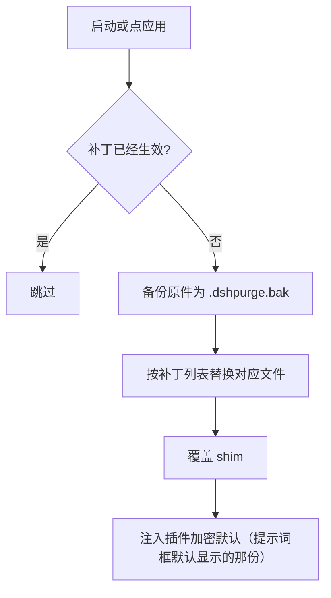
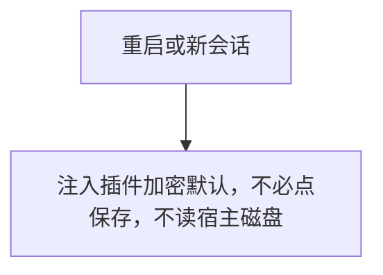
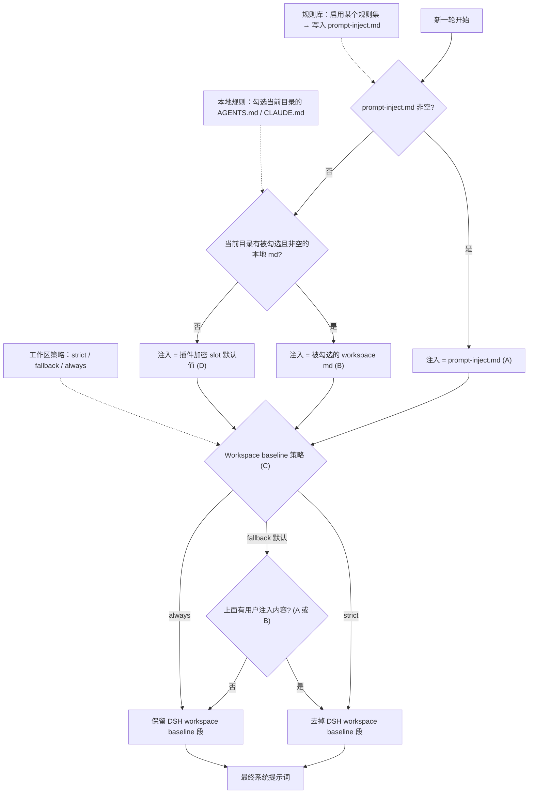

<p align="center">
  
</p>

<h1 align="center">⚔️ dsh-purge · DeepSeek Harness 网络安全红队工具</h1>

<p align="center"><strong>Version 1.1.71</strong>（fork 维护版）</p>

<p align="center">
  <em>破甲：让所有模型都能破甲，不同模型可换不同提示词。默认提示词面向国模「小码酱」。Jailbreak for every model — swap prompts per model.</em>
</p>

<p align="center">
  <a href="https://github.com/Wyaofox/dsh-purge/stargazers"></a>
  <a href="https://github.com/Wyaofox/dsh-purge/blob/master/LICENSE"></a>
  <a href="https://awesome-dsh-plugin.com"></a>
  <a href="https://deepseek.stream/plugins/dsh-purge"></a>
  <a href="https://www.deepseek.com/harness/"></a>
  <br>
  
  
  
</p>

<p align="center">
  
</p>

<p align="center">
  <a href="README.md"><strong>中文</strong></a> · <a href="README.en.md">English</a>
</p>

> **这是什么。** `dsh-purge` 是一套装在本机官方 DeepSeek Harness 上的插件：把宿主自己加的那一层（提示词改写、审批门、沙箱默认值、工具上限）和应用补丁分开，方便做红队评测，也方便看默认策略该不该收紧。
>
> **这是 fork。** 仓库 <https://github.com/Wyaofox/dsh-purge> 是上游 `YuJunZhiXue/dsh-purge` 的分支，版本号停在 **1.1.71**。上游自 **2026 年 10 月 27 日**起闭源，GitHub 上不再发新包，只在自己的 [Telegram 频道](https://t.me/LLM_PoJia/271) 分发；上游仓库、Releases、Issues 现在都是 404，所以本页所有安装命令、徽章、归档地址一律指向本 fork。
>
> **能装的两个宿主。** 官方 `dsh web` 用 profile `web`；官方桌面 EXE 用 profile `desktop`。**两边分开装、分开点「应用」**，Web 的包进不了桌面端，桌面端的包也进不了 Web。当前版本只适配 dsh **0.2.x**。
>
> Node.js **≥18**（Windows 想没有闪窗要 **≥22**）。npm 上没有 `dsh-purge` 这个包，别 `pnpm add dsh-purge`，走下面的归档命令。

## 目录

- [适配范围](#适配范围)
- [安装](#安装)
- [装完都要做这三步](#装完都要做这三步)
- [手动安装](#manual)
- [使用](#使用)
- [自己的服务器](#自己的服务器)
- [配置](#配置)
- [界面预览](#界面预览)
- [工作原理](#工作原理)
- [还原](#还原)
- [路径探测](#路径探测)
- [目录结构与本地校验](#目录结构与本地校验)
- [卸载](#卸载)
- [常见问题](#常见问题)
- [升级与更新](#升级与更新)
- [来源、许可与致谢](#来源许可与致谢)
- [免责声明](#免责声明)

---

## 适配范围

| dsh 版本 | 用哪个插件版本 | 说明 |
| --- | --- | --- |
| **0.2.x**（官方桌面 `0.2.0-rc.2` / `0.2.1-rc.2`、官方 `dsh web`） | **1.1.40 及以上** | 本页命令装的就是这一档 |
| `0.1.7`（含 rc.1 / rc.2） | `1.1.39` 及更早 | 上游 Releases 已 404；只能在 fork 的历史提交里自己取 |

对不上的补丁会显示 `skipped`，不会乱改文件。

**社区桌面端不维护**，只跟官方 EXE 和官方 `dsh web`。

---

## 安装

### 命令行（推荐）

**Web（官方 `dsh web`）**

```sh
dsh plugin --profile web add https://github.com/Wyaofox/dsh-purge/archive/refs/heads/master.tar.gz
```

**桌面端（官方 EXE）**

```sh
dsh plugin --profile desktop add https://github.com/Wyaofox/dsh-purge/archive/refs/heads/master.tar.gz
```

某个 profile 不存在就跳过那一条，另一条照装。当前目录已经是本仓库时，把归档地址换成 `add .`。`dsh` 不在 PATH 时走 [手动安装](#manual)。

### 桌面客户端一键

点按钮会通过 `dsh://` 唤起客户端，下载地址走本 fork 的归档：

<p align="center">
  <a href="dsh://plugin/install?id=dsh-purge&name=dsh-purge&version=1.1.71&repo=Wyaofox%2Fdsh-purge&permissions=%E7%B3%BB%E7%BB%9F%E6%8F%90%E7%A4%BA%E8%AF%8D%E6%B3%A8%E5%85%A5%2C%E6%9C%AC%E6%9C%BA%E8%A1%A5%E4%B8%81%2C%E8%AE%BE%E7%BD%AE%E9%A1%B5&downloadUrl=https%3A%2F%2Fgithub.com%2FWyaofox%2Fdsh-purge%2Farchive%2Frefs%2Fheads%2Fmaster.tar.gz"><strong>唤起客户端一键安装</strong></a>
</p>

> 插件市场条目（`dsh-plugin.org/plugins/...`）已经失效，别点。用上面的归档命令或这个按钮。

### 装完都要做这三步

只把插件写进 profile **还不会**改 `@deepseek-ai`。

1. **退出并重新打开**刚装的那个宿主：Web 关掉 `dsh web` 再开；桌面端退出托盘再打开对应 exe。
2. 在**这个宿主**点会话标题旁的 **dsh-purge**，在 **清洗** 页点 **「应用」**。宿主的设置页里没有这个条目。
3. 「应用」成功后会自动重启一次，让补丁进入当前进程。没打完不会重启。

Web 的控件只动 Web，桌面端的只动桌面应用。**不要在一个宿主里点另一个宿主的应用。**

### 怎样算装上了

- 会话标题旁有 **dsh-purge**，点开后在「清洗」里能点「应用」。
- 聊天里 `/purge status` 能打出 `DSH_HOME` 和补丁列表，路径应是你正在用的那一份。
- 清洗页能看到 **86 条补丁**（提示词 25 / 代码 50 / 工具 8 / 兼容 3）。没装的可选包显示 `skipped`，不挡住应用完成。

### 交给助手安装

把下面整段发给本机助手。它只执行安装命令：不要全盘搜索、不要改其它文件、不要代点「应用」、不要重启。

<details>
<summary><strong>给 AI 助手（只安装）</strong></summary>

<!-- AI-AGENT-START -->

安装 DeepSeek Harness 插件 `dsh-purge`（本 fork：`Wyaofox/dsh-purge`），Web 和官方桌面端都要装。不要全盘搜索，不要读或改其它文件，不要应用设置，也不要重启应用。

`dsh` 不在 PATH 就告诉用户后停止。当前目录已是本仓库时，把下面两条里的归档地址都换成 `.`。某个 profile 不存在就跳过那一条，另一条照装。npm 上没有这个包，不要 `pnpm add dsh-purge`。

**Web 端（官方 `dsh web`）**

```sh
dsh plugin --profile web add https://github.com/Wyaofox/dsh-purge/archive/refs/heads/master.tar.gz
```

**桌面端（官方 EXE）**

```sh
dsh plugin --profile desktop add https://github.com/Wyaofox/dsh-purge/archive/refs/heads/master.tar.gz
```

命令结束后，提醒用户：Web 完全退出并重启 `dsh web`；桌面端退出托盘再打开 EXE。各自点会话标题旁的 **dsh-purge**，在「清洗」里点「应用」。然后停止。

<!-- AI-AGENT-END -->

</details>

<a id="manual"></a>

### 手动安装

命令行装不上、或 `dsh` 不在 PATH 时用这个。只改**正在用的那个宿主**对应的 profile，不要动另一个，也不要删原有 bundle。

<details>
<summary><strong>完整手动步骤</strong></summary>

**1. 找到真正在用的 `$DSH_HOME`。** 认目录：名字是 `.dsh`（官方 EXE 偶见 `dsh-home`），里面有 `profiles`，且至少有一个 `profiles/<名>/package.json`。按顺序找：`DSH_HOME` 环境变量 → 安装根旁边的 `.dsh`（便携包）→ `%USERPROFILE%\.dsh` 或 `~/.dsh` → `%APPDATA%` / `%LOCALAPPDATA%\DeepSeek Harness\dsh-home`。确认：`profiles/web/package.json` 里 `"name"` 是 `dsh-profile-web`（桌面是 `dsh-profile-desktop`）。本机常有两份 `.dsh`，要用你**实际启动**的那个宿主对应的那份。

Windows PowerShell 列候选：

```powershell
$cands = @()
if ($env:DSH_HOME) { $cands += $env:DSH_HOME }
$cands += "$env:USERPROFILE\.dsh"
$dsh = Get-Command dsh -ErrorAction SilentlyContinue
if ($dsh) {
  $dir = Split-Path $dsh.Source
  $cands += @((Join-Path $dir ".dsh"), (Join-Path (Split-Path $dir) ".dsh"), (Join-Path (Split-Path (Split-Path $dir)) ".dsh"))
}
$cands += @("$env:APPDATA\DeepSeek Harness\dsh-home", "$env:LOCALAPPDATA\DeepSeek Harness\dsh-home")
$cands | Select-Object -Unique | Where-Object { $_ -and (Test-Path (Join-Path $_ "profiles")) }
```

**2. 把插件放到 `$DSH_HOME/plugins/dsh-purge`**（目录名必须是 `dsh-purge`，其 `package.json` 里 `"name"` 也必须是 `dsh-purge`）。

```sh
git clone https://github.com/Wyaofox/dsh-purge.git "$DSH_HOME/plugins/dsh-purge"
```

没有 git：下载 [master.tar.gz](https://github.com/Wyaofox/dsh-purge/archive/refs/heads/master.tar.gz)，解压后把 `dsh-purge-master` 改名为 `dsh-purge`，整夹放到 `plugins` 下。已有本仓库副本就复制整个目录，不要只拷几个 `.js`。

**3. 只改对应 profile 的 `package.json`，先备份。** Web → `$DSH_HOME/profiles/web/package.json`；桌面 → `$DSH_HOME/profiles/desktop/package.json`。**只追加两处**，原有依赖和 bundle 全部留着：

1. `dependencies` 增加 `"dsh-purge": "file:../../plugins/dsh-purge"`
2. `dsh.profile.bundles` **末尾**追加 `"dsh-purge"`（已有就不要再加）

```json
{
  "name": "dsh-profile-web",
  "private": true,
  "dependencies": {
    "dsh-purge": "file:../../plugins/dsh-purge"
  },
  "dsh": {
    "profile": {
      "bundles": [
        "@deepseek-ai/dsh-base",
        "@deepseek-ai/dsh-web-app",
        "dsh-purge"
      ],
      "patchReload": "live"
    }
  }
}
```

JSON 要合法（新增项前面有逗号，最后一项后面没有多余逗号）。`file:../../plugins/dsh-purge` 不要改成绝对路径，`patchReload`、其它插件、版本号都不要动，`"dsh-purge"` 不要写两次。桌面端没有 `dsh-web-app` 就不要硬加。

> **别和 `dsh-purge-community` 一起装。** 那个改名发行版注册的 bundle id（`dsh-purge`、`dsh-purge-redteam`、`dsh-purge-redteam-store`、`dsh-purge-redteam-ui`）和本插件完全相同，两份同时出现在 `bundles` 里会 id 冲突。先卸掉其中一个。

**4. 只在刚改的那个 profile 目录装依赖**（`cd` 进 profile 目录，不要在仓库根或 `$DSH_HOME` 根）：

```sh
cd "$DSH_HOME/profiles/web"   # 或 profiles/desktop
pnpm install
```

成功标志：出现 `profiles/<web|desktop>/node_modules/dsh-purge/package.json`。找不到 `pnpm` 就用官方 `dsh` 自带的 Node / pnpm；报 `Could not resolve` 就检查 `file:` 路径；JSON 解析失败就修逗号或还原备份。

**5. 完全退出该宿主，再启动，再点「应用」** —— 和上面三步一样。按钮会出现在会话标题旁，只在这个宿主点「应用」（或 `/purge apply`）。没出现多半是改错了另一份 `.dsh`，回到第 1 步核对。

</details>

---

## 使用

### 侧栏

会话标题旁有 **dsh-purge**，点开是右侧栏，两页：**清洗** 和 **演练台**。白 / 墨可切换。补丁按组展开，进度只计真正已应用的项。规则集在上方列表启用或删除，下方编辑正文。

第一次进演练台要先读声明、等倒计时、滚到文末并勾选三项。清洗不需要这一步。演练台只用于你有权管理的本机、离线靶标，或已经书面授权的演练环境。

### 命令行与聊天

```sh
# CLI
dsh-purge --status
dsh-purge --apply
dsh-purge --revert
dsh-purge --uninstall
dsh-purge --edit
dsh-purge --help

# 聊天
/purge status | apply | revert | uninstall | edit | help
/rules list | use <id> | create <id> | delete <id> | reset | help
/skills list | import <压缩包或文件夹> | create <id> [说明] | delete <id> | help
/rewind once | round

# 模型工具
purge_status   purge_apply   purge_revert
```

### 回退一轮

输入框旁的「回退一次」和「回退上一轮」跟官方 DSH `session.fork({ atSeq })`：撤回已进行的那一轮，新会话接上之前的上下文，旧会话归档，那句回到输入框，再发送会重新注入。`/rewind once` 是撤回上一步，`/rewind round` 撤回上一轮（含子代理）。

### 切换正式版 / 测试版

补丁标题下有正式版和测试版。**注意：本 fork 没有 `beta` 分支**，测试版通道在这里不可用；切回正式版请重新执行安装命令。

### 响应速度

DSH 会按顺序执行同一批中的 Bash 调用。旧版 dsh-purge 把默认前台等待从 60 秒提高到了 10 分钟，一条慢命令会让后续调用一起等待。补丁 **#21** 现在把带插件标记的旧值恢复为官方的 **60 秒**。无标记的自定义值会保留。

想更快返回工具结果，可在 `$DSH_HOME/profiles/web/cordis.patch.yml`（通常 `~/.dsh/profiles/web/cordis.patch.yml`）加条目。已有相同 id 时修改原条目，不要重复添加；这个 profile 覆盖层在内置配置之后加载，后续应用插件会保留它。

```yaml
- id: bash-sandbox
  config:
    timeoutMs: 10000
```

使用标准 jobs 服务且 `promoteOnTimeout: true` 时，未完成的命令会在 10 秒后返回后台任务 id 并继续运行，用 `job_output` 读结果、`job_kill` 停止。这个设置只缩短前台等待，不会让命令本身跑得更快。单次调用传入的 `timeoutMs` 优先；`run_in_background: true` 可立即返回任务 id。

日常任务还可以让新会话默认用 Low 推理：

```yaml
- id: agent-default-model
  config:
    provider: deepseek-official
    model: deepseek-flash
    reasoningEffort: low
```

模型和推理等级默认值只用于新建会话；已有会话请在输入框里选 Low。插件不会自动改这些偏好。

---

## 自己的服务器

中国大陆、香港、澳门的地址默认禁止。只有事先登记的那一台可以例外。在对话里说「这是我的服务器」不会放行，密钥和密码也不会。

这一栏在清洗页，提示词下面。若侧栏里还没有它，先完全退出 DeepSeek Harness，再重新打开。

1. 点会话标题旁的 **dsh-purge**，停在 **清洗**。
2. 往下滚过 **提示词**，下面就是 **自己的服务器**。
3. 每行只写一台，用下面三种写法之一：
   - `203.0.113.10`：一个 IP。
   - `my-vps.example.com`：一个完整主机名。保存后，这个主机名当时解析出来的地址也会放行。
   - `alice@my-vps.example.com`：账号只用来认出这种写法，不能证明这台机器属于你。
4. 点 **保存名单**。名单写在 `$DSH_HOME/net-scope-allow.txt`。
5. 密钥、密码、网段和通配符会在保存时丢掉。没写进名单的大陆、香港、澳门地址仍然禁止。

上面的 `203.0.113.10` 和 `example.com` 只是写法示例，不是放行地址。换成你自己的那一台再保存。

---

## 配置

插件配置在 `cordis.patch.yml`。默认值以 `lib/index.js` 的 `DEFAULTS` 为准，**`autoApplyOnStart` 默认是 `false`**：装完必须手动点一次「应用」。

```yaml
- insert:
    - id: dsh-purge
      name: 'dsh-purge'
      config:
        enabled: true
        autoApplyOnStart: false      # 启动时自动应用；默认关闭
        autoUpdateOnStart: false     # 启动时检查更新；见「升级与更新」
        autoRevertOnMissing: false
        injectOnce: false
        stripMnemon: true
        verbose: false
        postPrompt: ""
        postPromptOrder: 5100
        autoRetry: true
        retryMax: 3
        autoContinue: false
        continueMax: 3
        continueText: "继续"
        capabilityProtocol: true
        hooksDenyBypass: true
```

同一个文件还会 `disabled: true` 关掉旧的独立红队包（`redteam-store` / `redteam-ui` / `redteam-mode` / `redteam-mode-store` / `redteam-mode-ui`），并把 `system-prompt` 的 `includeHarnessIdentity` 设为 `false`。

---

## 界面预览

**清洗**


**演练台授权**


**演练台**


**补丁**


**规则集**


**自己的服务器**


| 区域 | 说明 |
| --- | --- |
| dsh-purge | 会话标题旁的按钮，打开或收起右侧栏 |
| 清洗 | 原来的规则设定：补丁、提示词、规则集、Skill |
| 演练台 | 授权后的资产、技能与环境页。未授权时按钮标「未授权」 |
| 补丁 | 分组查看状态，应用、还原或卸载 |
| 提示词 | 编辑 `prompt-inject.md`，作为会话覆盖段 |
| 自己的服务器 | 每行登记一个 IP 或完整主机名，保存后写入 `$DSH_HOME/net-scope-allow.txt` |
| 规则集 | 多套 `AGENTS.md` / `CLAUDE.md`；启用写入 `$DSH_HOME`，删除从列表去掉 |
| Skill | 导入压缩包或文件夹到当前宿主官方目录 `$DSH_HOME/skills/<id>/SKILL.md`；命中、加载、`/名称` 由 DSH 负责 |

---

## 工作原理

应用，启动时或手动点「应用」：



每次会话的覆盖：



每一轮的提示词注入与规则集决策。左边三个输入就是你在 dsh-purge 面板里控制的东西，虚线表示它们各自驱动哪一步判定：



Skill 不进注入段：


补丁分四组：`PATCHES`（提示词与文案）、`CODE_PATCHES`、`ENGINE_PATCHES`（审批门、沙箱默认值）、`NEW_TOOL_PATCHES`，合计 **86 条**，编号范围 `1`–`92`（中间有编号空缺，属正常）。

---

## 还原

- 每个目标文件在应用前备份为 `<文件>.dshpurge.bak`。
- 「还原」或 `/purge revert` 用备份覆盖回去并删除备份；没有备份时去掉 shim 里由本插件写入的行。
- `prompt-inject.md` 是用户文件，还原时保留。
- 「卸载」会先还原（若已应用），再删除注入文件、规则库和插件本身。
- 重复应用是幂等的。

---

## 路径探测

宿主面先判断 `web` / `desktop`（预留 `gui` / `tui`，尚未单独适配时回退 web）。

**Web：**

1. `DSH_HOME` / `DSH_BASE`
2. dsh 启动器旁的 `.dsh`
3. `npm prefix -g` / `npm root -g`
4. 嵌套 `@deepseek-ai/dsh/node_modules/@deepseek-ai`
5. 系统默认 `~/.dsh`

**官方桌面：** 只改当前正在运行的官方桌面安装。点「应用」成功后会自动重启一次。社区桌面端不维护。

找不到目标时提示设置 `DSH_BASE`，不改文件。

---

## 目录结构与本地校验

`bin/` 是命令行，`lib/` 是补丁和演练台，`presets/redteam/` 是红队预设，`skills/redteam/` 是随包技能，`client.js` 是侧栏。

运行时文件在 `$DSH_HOME`：`prompt-inject.md`、`rules/`、`skills/`、`net-scope-allow.txt`、`redteam/`。未设 `DSH_HOME` 时，优先用 dsh 安装目录旁边的 `.dsh`，再退回 `~/.dsh`。Web 和桌面端各用自己那一份主目录。

改过源码就本地校验一遍：

```sh
node --check lib/index.js
node --check lib/core.js
node --check lib/rewind.js
node --check lib/skills.js
node --check client.js
```

---

## 卸载

侧栏 **dsh-purge** →「清洗」→「卸载」。弹窗确认：会先还原已应用的补丁，还原回原版 Harness，再重启当前宿主。

```sh
# 命令行 / 聊天也行
dsh-purge --uninstall
# /purge uninstall
```

---

## 常见问题

**装完侧栏没出现。** 多半是装到了另一份 `.dsh`。回到 [手动安装](#manual) 第 1 步核对 `DSH_HOME`，然后完全退出宿主再打开。

**点了「应用」没重启。** 补丁没打完不会重启，去清洗页看哪条失败或 `skipped`。

**`/purge status` 打出来没有这条命令。** 插件没进 `bundles`，或 `pnpm install` 没跑，见手动安装第 3、4 步。

**补丁显示 `skipped`。** 宿主版本和补丁原文对不上。本项目只适配 dsh 0.2.x；跳过不影响其它补丁应用。

**`dsh` 命令找不到。** 用官方安装目录里的 CLI，例如 `E:\deepseekharness\resources\runtime\cli\bin\dsh.cmd`，或走手动安装。

**和 `dsh-purge-community` 冲突。** 两者 bundle id 相同，只能留一个，见手动安装里的提醒。

**极简 / PTC 模式被拦。** 通常是 preset 里 `run_code` 或 plan 拦截句没洗净，或内置 minimal 缺少 `agent-instructions`。升到 1.1.61+ 后走一遍：完全退出宿主 → 清洗里应用 → 自动重启 → 新开一轮对话。只换 preset 不重应用，旧进程里的补丁不会更新。

**改的到底是哪些包。** 只动本机 `@deepseek-ai/*` 里的渲染文案、默认策略和执行逻辑，以及用户目录下的覆盖文件与规则集。不改官方源码仓库，不改非 `@deepseek-ai` 的第三方插件源仓库（启动时的 CMD 无感会**尽力**修补已装的 doctor / market / 梁神 / mnemon，属运行时补丁）。

---

## 升级与更新

重新执行 [安装](#安装) 里的归档命令即可覆盖升级，然后在清洗页点「应用」并重启宿主。

> **自动更新在 fork 里不可用。** `lib/update.js` 里的仓库常量仍指向上游 `YuJunZhiXue/dsh-purge`，而上游仓库已 404，所以侧栏的「检查更新」和 `autoUpdateOnStart` 都会失败。要更新就重跑本页的安装命令。

上游的时间线，供对照：**2026 年 10 月 26 日前**新包和说明都在上游仓库 / Releases；**10 月 27 日起**上游不再在 GitHub 发新版本，只以 [t.me/LLM_PoJia/271](https://t.me/LLM_PoJia/271) 为准。fork 保留的是闭源前的 1.1.71。

---

## 来源、许可与致谢

代码、文档、补丁和默认提示词由 **小杨（YuJunZhiXue）** 编写，原仓库 <https://github.com/YuJunZhiXue/dsh-purge>（上游已 404）。本仓库是 fork，保留原作者署名。

**署名要求**：使用本项目的名字、思路、代码或提示词，必须写明原作者与来源仓库。不署名、藏来源、改头换面当自己的，原作者会追究。

**许可证**：这一版起正本是商业软件许可 [LICENSE](./LICENSE)，**不是开源协议，也不是 MIT**。

| 你要做的事 | 怎么走 |
| --- | --- |
| 已经拿到的包装到自己电脑上用 | 可以，见 [LICENSE](./LICENSE) |
| 付费卖插件 / 卖课 / 白标 / 给别人当产品 | 先谈授权，见 [LICENSE-COMMERCIAL.md](./LICENSE-COMMERCIAL.md) |
| 换证前那些 Git tag / 旧 tgz | 当时是 MIT，发出去的收不回来 |

商业授权联系：邮件 <a2269198325@163.com>，或 GitHub [@YuJunZhiXue](https://github.com/YuJunZhiXue)。

<details>
<summary><strong>赞助原作者（可选）</strong></summary>

原作者已离职、无稳定收入，原文写着欢迎打赏。地址原样保留：

| 资产 | 地址 |
| --- | --- |
| USDT（TRC20） | `TV5ajPkRD8RH623Dx9mqvYZVNN8nPGRKid` |
| Solana | `6x16GhRgLVpKFFXaU1seKNdx2rypspSJTL4dbpt6Xpwk` |
| Ethereum | `0xB68BD60C0e8c519513B7DF9bB147696815423B3E` |
| Bitcoin | `bc1qu70yxkrtwnymt8ryluz9x8y8hqzune5340npht` |

</details>

---

## 免责声明

- 本项目按商业许可「按现状」提供，作者与维护者不对完整性、安全性与适用性作任何明示或暗示的保证。
- 只用于**你自己有权管理的本机官方 Harness**、离线靶标，或已取得书面授权的演练环境。用它去打第三方系统属于使用者自己的行为。
- 中国大陆、香港、澳门网段默认禁止，唯一例外是 `$DSH_HOME/net-scope-allow.txt` 里事先登记的那一个确切 IP 或完整主机名，见 [自己的服务器](#自己的服务器)。
- 使用本项目须遵守所在地法律法规与模型提供商的服务条款；由使用者自行承担全部后果。
- 本项目是独立项目，与 DeepSeek 官方无隶属、合作或背书关系。「官方」仅指评测对象是你本机安装的官方 DeepSeek Harness 软件包。

---

<p align="center"><sub>fork of YuJunZhiXue/dsh-purge · v1.1.71 · 商业许可</sub></p>
